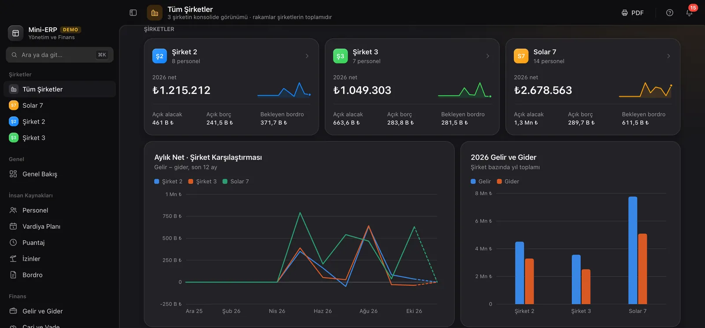
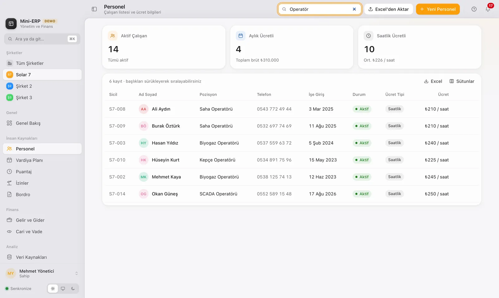
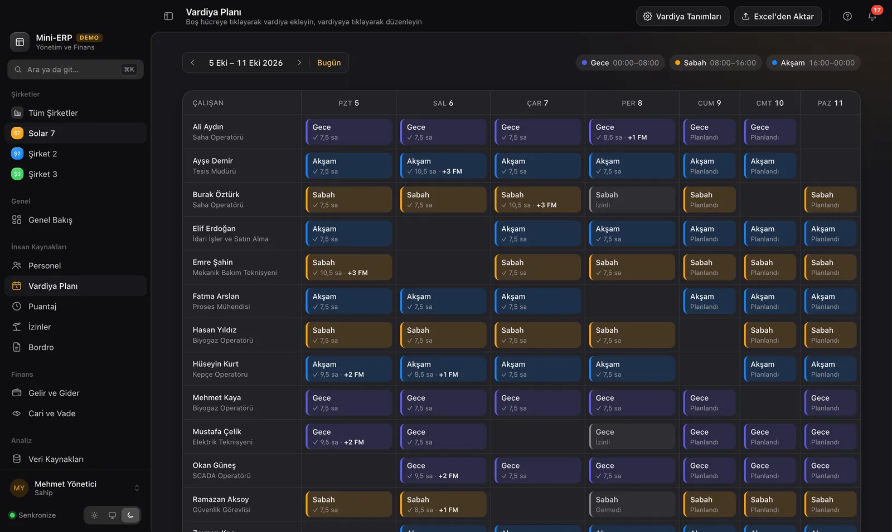
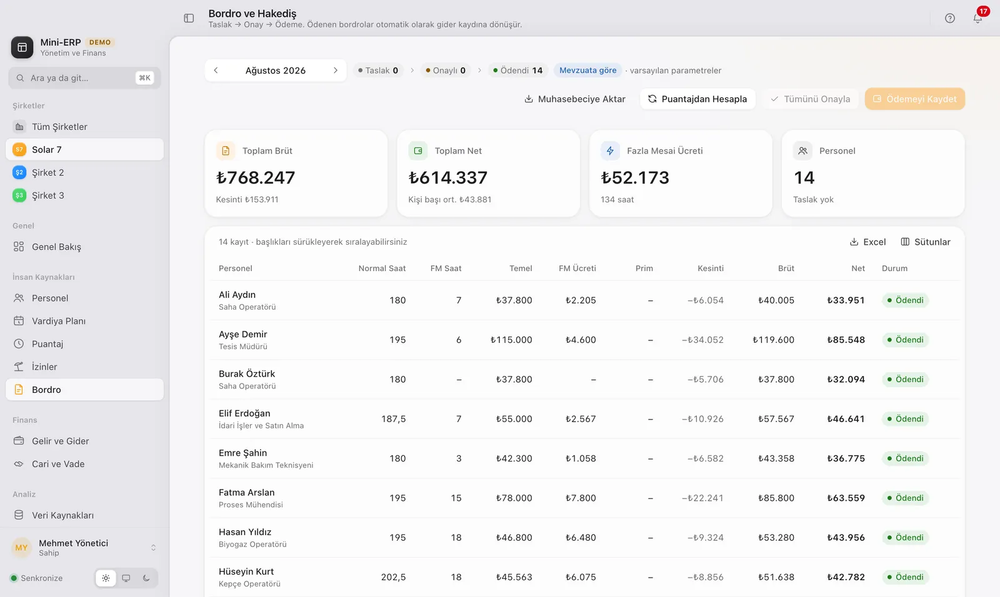
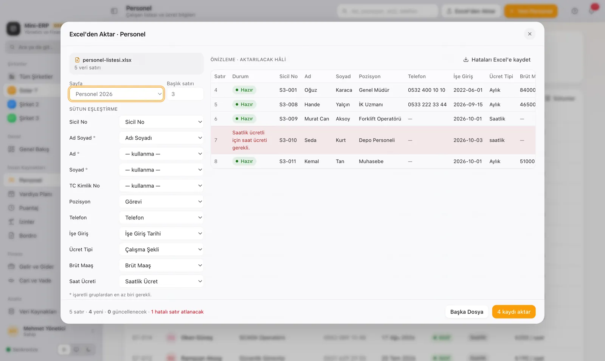
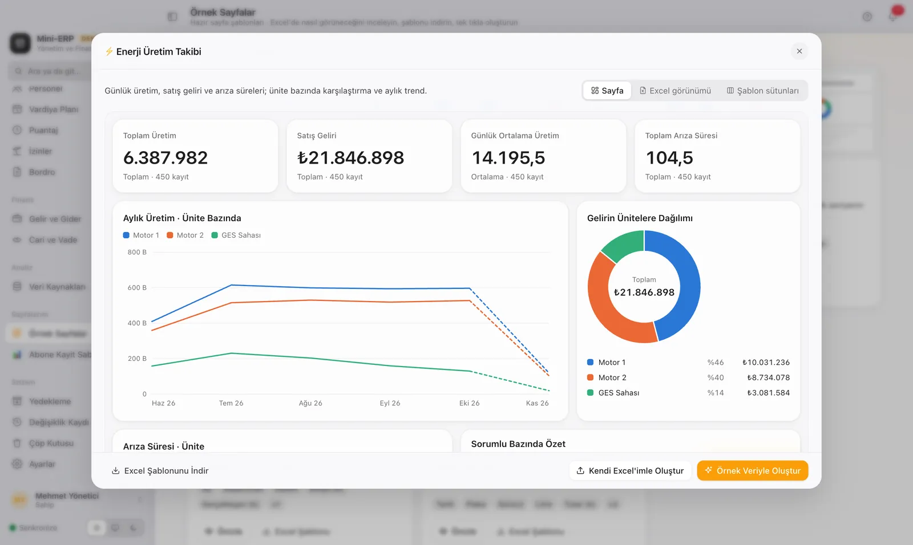
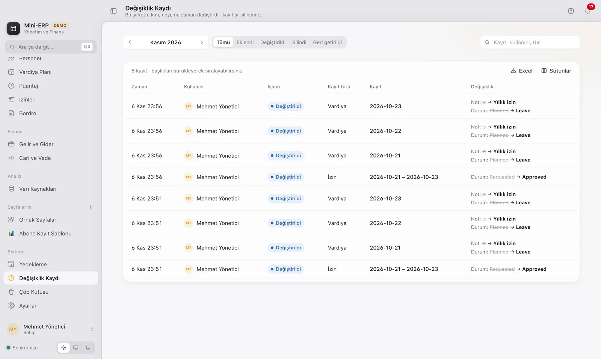

# Mini-ERP

**Birden fazla şirketi tek uygulamadan yöneten masaüstü ERP: personel, vardiya, puantaj, izin, Türk bordrosu, cari hesaplar ve gelir-gider.**

Electron + React arayüz, .NET Clean Architecture backend. Her şirketin verisi birbirinden izole (testlerle doğrulanmış multi-tenant yapı); istenirse tüm şirketler tek bir konsolide görünümde izlenebiliyor. Çok kullanıcılı kullanım için Docker + Caddy ile sunucu kurulumu, tanıtım için ise sunucusuz, tek tık kurulumlu bir demo paketi var.



## Özellikler

**İK**
- Personel kartları, filtreleme ve Excel/CSV'den toplu içe aktarma
- Vardiya planlama ve puantaj
- İzin yönetimi (izin kuralları testlerle doğrulanmış)

**Finans**
- Türk bordro hesaplaması: SGK, gelir vergisi dilimleri, damga vergisi, ay ortasında giren/çıkan için kıst gün
- Cari hesaplar, gelir-gider takibi
- Muhasebeciye aktarım çıktısı

**Platform**
- Çok şirketli yapı: şirket bazlı veri izolasyonu ve konsolide görünüm
- Excel verisinden sürükle-bırak rapor ve sayfa oluşturucu (grafik widget'ları)
- Denetim kaydı (kim, neyi, ne zaman değiştirdi), çöp kutusu, JSON yedekleme
- Uygulama içi ürün turu, komut paleti, koyu/açık tema
- JWT kimlik doğrulama, giriş denemelerinde rate limit

| Personel | Vardiya planı | Bordro |
|---|---|---|
|  |  |  |
| **Excel içe aktarma** | **Rapor galerisi** | **Denetim kaydı** |
|  |  |  |

## Mimari

```
desktop/   Electron 44 + React 19 + TypeScript + Zustand + Tailwind 4 (Vite)
  └── HTTP (JWT) ──►
backend/   .NET 10, Clean Architecture
  ├── MiniErp.Domain          varlıklar ve iş kuralları (bordro, izin)
  ├── MiniErp.Application     kullanım senaryoları
  ├── MiniErp.Infrastructure  EF Core, SQL Server / SQLite
  ├── MiniErp.Api             ASP.NET Core API
  └── tests/MiniErp.Tests     xUnit
```

Üç çalışma şekli var:

| Mod | Veritabanı | Kullanım |
|---|---|---|
| Geliştirme | SQL Server (Docker) | `dotnet run` + `npm run dev` |
| Sunucu | SQL Server + API + Caddy (otomatik HTTPS), `docker compose` | Çok kullanıcılı, ofis içi |
| Sunucusuz demo | API uygulamaya gömülü, yerel SQLite, sadece `127.0.0.1` | Tek tık kurulum, .NET gerekmez |

## Testler

```bash
cd backend && dotnet test     # 15 test: bordro, Türk bordrosu/kıst gün, izin kuralları, şirket izolasyonu
cd desktop && npm test        # 23 test: Excel ayrıştırma ve normalizasyon, rapor/sayfa motoru
```

Şirket izolasyonu testleri; yeni kaydın aktif şirkete bağlandığını, diğer şirketin bu kaydı göremediğini, başka bir şirkete kayıt eklenemediğini ve şirket seçilmeden kayıt yapılamadığını doğruluyor.

## Hızlı başlangıç

```bash
docker start minierp-sql   # ya da: docker compose up -d sql
cd backend && dotnet run --project src/MiniErp.Api --urls http://localhost:5080
cd desktop && npm install && npm run dev
```

Demo giriş: `yonetici@ornek.com` / `MiniErp2026!` · Örnek veriyi baştan üretmek: `dotnet run --project src/MiniErp.Api -- --seed`

Sunucu kurulumu, masaüstü paketleme ve sunucusuz demo paketi için: **[KURULUM.md](KURULUM.md)**. Hazır Windows demo kurulumu [Releases](../../releases) sayfasında.

`ornek-excel-dosyalari/` içindeki personel, vardiya ve üretim tabloları içe aktarmayı denemek için hazırlanmış **uydurma** verilerdir.

## Bilinen sınırlar

- Bordro parametreleri (2026 asgari ücret, vergi dilimleri) tahminidir; her yıl mali müşavirle doğrulanmalıdır. Teşvik ve engellilik indirimi gibi özel durumlar hesaplanmaz.
- Kurulum paketleri imzasız; Windows SmartScreen ve macOS Gatekeeper uyarı verir.

## Nasıl geliştirildi

Uygulamayı Claude Code ile uçtan uca geliştirdim: işi modüllere bölüp planladım, parçaları ayrı ajanlara yazdırdım ([Pano](https://github.com/sevincmehmet/pano) ile yönettim), testler ve gözden geçirme ile birleştirdim.
